# Control iOS: documento funcional (estado actual)

Relevamiento de la app gestora **Homita Control** (`apps/control-ios`, iOS 17+, SwiftUI) tal como está hoy. Pensado como entrada para un agente que diseñe wireframes y proponga mejoras de UX y UI: describe pantallas, flujos, formularios, datos y de qué endpoint sale cada cosa. No propone cambios.

Las capturas salen del simulador iPhone 17 contra el stack **local** (cuenta demo `demo@homita.example`, hogar «Hogar de Familia Demo»). Están en `docs/images/ios-auditoria/`.

## 1. Cómo se reproduce

- Config local (no commitear): `apps/control-ios/Config.xcconfig` apuntando a `http://127.0.0.1:54321`.
- Backend local: `scripts/demo.sh up` (reset y seed de la base local, `functions serve`).
- Tests de auditoría: `xcodebuild test -scheme ControlApp -destination 'platform=iOS Simulator,name=iPhone 17'`. El target `ControlAppUITests` recorre la app y adjunta una captura por pantalla.
- Las capturas se extraen del `.xcresult` con `xcrun xcresulttool export attachments`.

## 2. Actores y permisos

| Actor | Qué ve |
|---|---|
| Visitante | Bienvenida, login y registro |
| Miembro | Pestañas con sus datos. Ve Administración del hogar en solo lectura (configuración y administradores) |
| Admin del hogar | Todo: edición de configuración, miembros, invitaciones, accesos y auditoría |

El cliente solo oculta; el servidor decide (403 con mensaje de administrador).

## 3. Mapa de navegación

```
Sin sesión
└── Bienvenida ──┬── Iniciar sesión ──► Login ──► (sesión) Pestañas
                 └── Registrarse ─────► Registro (Nombre, Email, Contraseña, Código opcional)

Con sesión: barra inferior con 5 pestañas
├── Inicio      ── resumen del día; accesos rápidos a Tareas, Rutinas y Eventos
├── Tareas      ── segmentos [Tareas | Listas]
│   ├── Tareas: agrupadas por lista, filtro, botón «+ Nueva tarea»
│   │   └── Editor de tarea (título, lista)
│   └── Listas: «Nueva lista» ── Detalle de lista ── «Editar lista» / «Eliminar lista»
├── Calendario  ── segmentos [Eventos | Rutinas | Calendarios]
│   ├── Eventos: «Nuevo evento» ── Detalle de evento
│   ├── Rutinas: «Nueva rutina» ── Editor de rutina (frecuencia, hora, inicio/fin, activa)
│   └── Calendarios: «Nuevo calendario» ── Detalle de calendario
├── Hogar       ── selector de hogar, miembros, «Invitar», «Administración»
│   └── Administración: Configuración · Administradores · Miembros · Invitaciones · Accesos · Auditoría
└── Perfil      ── cuenta, familia (personas), «Unirse a un hogar», cerrar sesión
    ├── Personas: «Nueva persona»
    └── Unirse a un hogar (código de invitación)
```

Cambio de pestaña desde Inicio: «Tareas pendientes» abre la pestaña Tareas; «Rutinas de hoy» y «Hoy · Eventos» abren Calendario en su segmento correspondiente.

## 4. Pantallas, con captura

### 4.1 Entrada sin sesión

| Pantalla | Captura | Qué hay | Acciones |
|---|---|---|---|
| Bienvenida | 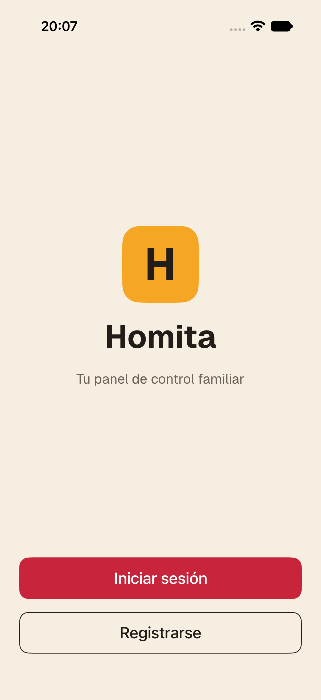 | Logo «H», nombre «Homita», subtítulo «Tu panel de control familiar» | «Iniciar sesión» (primario), «Registrarse» (secundario) |
| Login | 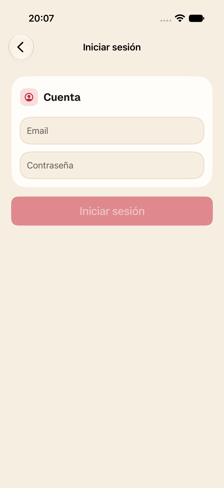 | Campos Email y Contraseña | «Iniciar sesión» (se activa con datos válidos) |
| Login con error | 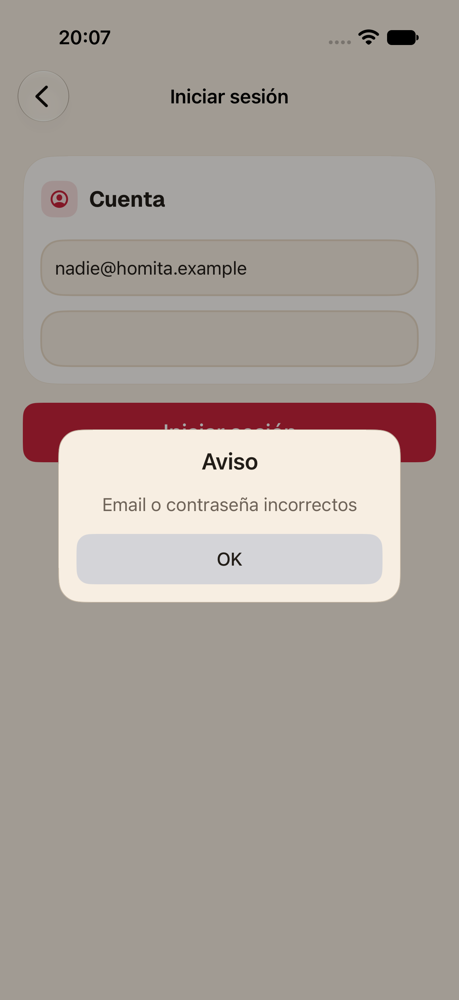 | Error tras credenciales incorrectas | Reintentar |
| Registro | 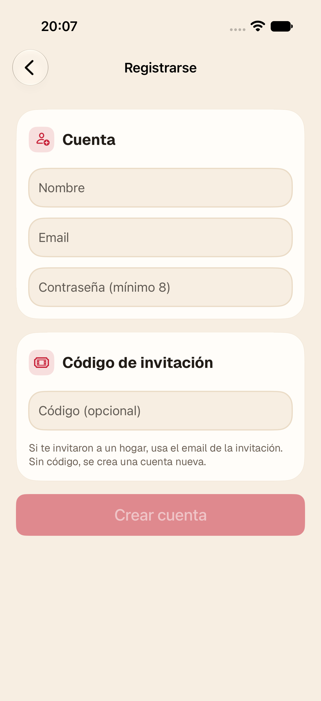 | Nombre, Email, Contraseña (mín. 8), Código (opcional) | «Crear cuenta» |

El botón «Registrarse» se muestra siempre; en producción el backend puede tener el registro desactivado (`allow_registration`). Eso está abierto en el brief del change `control-ios-mejoras`.

### 4.2 Pestañas

| Pestaña | Captura | Contenido |
|---|---|---|
| Inicio |  | Resumen del día: eventos de hoy, tareas pendientes, rutinas de hoy (calculadas en cliente), accesos rápidos |
| Tareas | 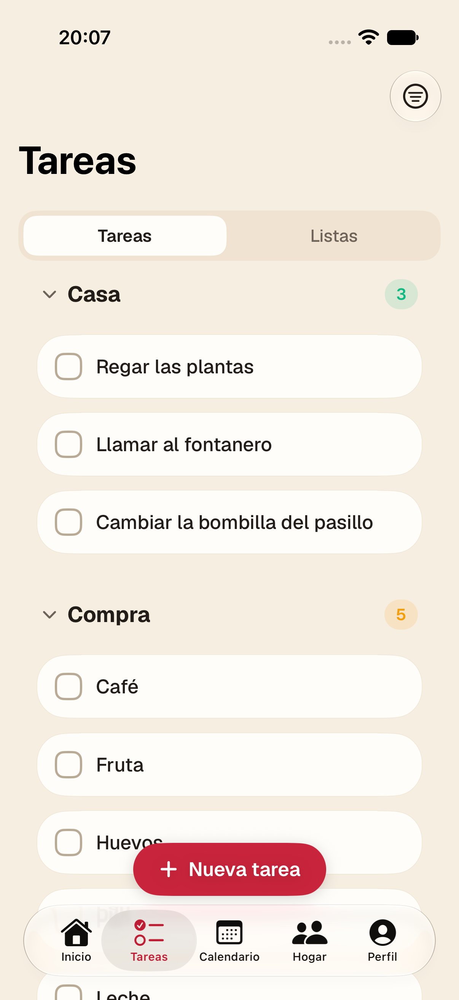 | Lista de tareas agrupadas, filtro, botón «Nueva tarea» |
| Calendario |  | Segmentos Eventos, Rutinas, Calendarios |
| Hogar | 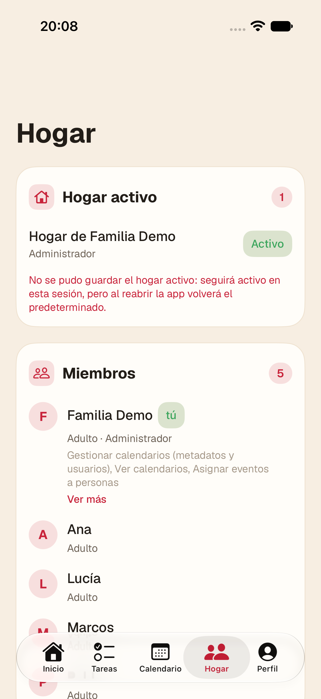 | Hogar activo, miembros, invitar, Administración |
| Perfil | 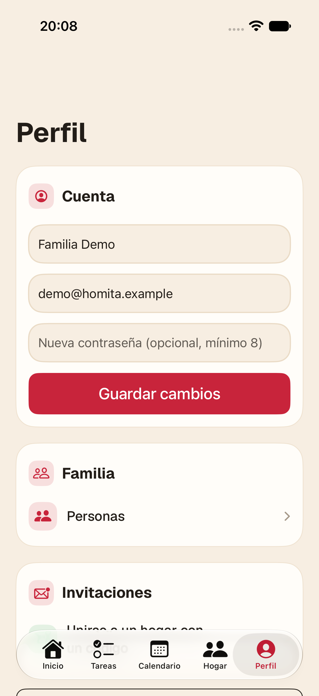 | Cuenta, Familia, cerrar sesión |

### 4.3 Inicio

| Captura | Qué muestra |
|---|---|
| 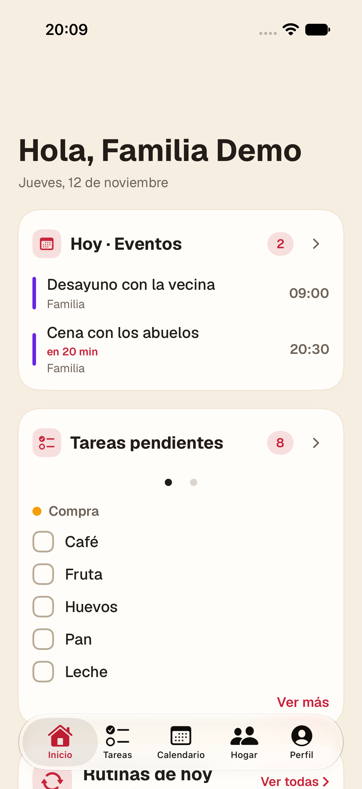 | Secciones «Hoy · Eventos», «Tareas pendientes», «Rutinas de hoy» y «ACCESOS RÁPIDOS». Tarjetas con «Ver más» |

El botón «+ Evento» del Inicio no apareció en el recorrido automático; la acción de alta de evento queda cubierta desde el segmento Eventos.

### 4.4 Tareas

| Pantalla | Captura | Qué muestra | Acciones |
|---|---|---|---|
| Tareas (lista) | 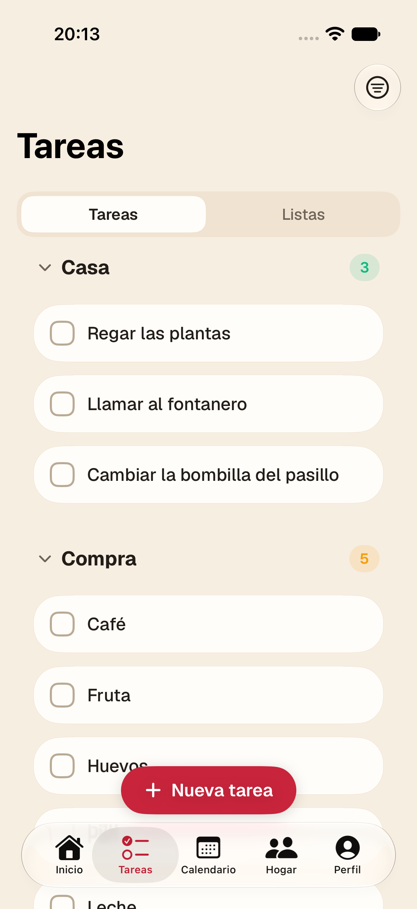 | Segmento «Tareas» activo. Grupos por lista con contador (p. ej. «Casa» 3, «Compra» 5), casillas para completar, botón flotante «+ Nueva tarea» | Marcar completada, filtrar (icono de filtro), abrir tarea |
| Tareas › Listas | 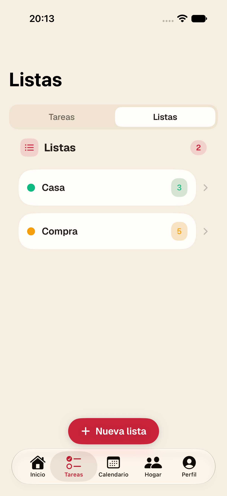 | Segmento «Listas» | «Nueva lista», abrir lista |
| Nueva lista |  | Nombre, Color, Widget, Dashboard | Cancelar, Crear |
| Nueva tarea | 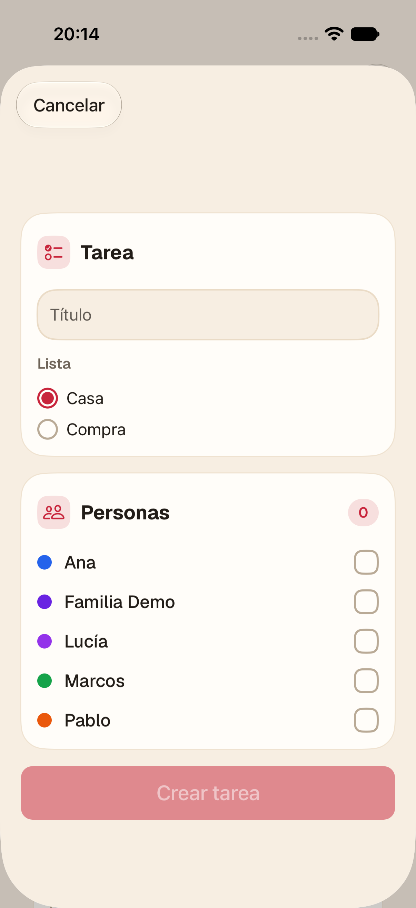 | Título, Lista | Cancelar, Crear |

Las listas tienen flags propios «Widget» y «Dashboard». En la lista de tareas aparecen los estados Pendientes y Completadas.

### 4.5 Calendario

| Pantalla | Captura | Qué muestra | Acciones |
|---|---|---|---|
| Eventos | 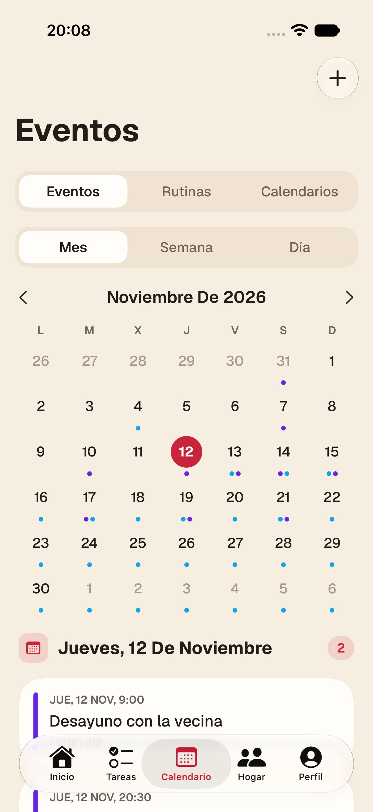 | Eventos por día con cuenta atrás (`EventCountdownLabel`) | «Nuevo evento», abrir evento |
| Rutinas | 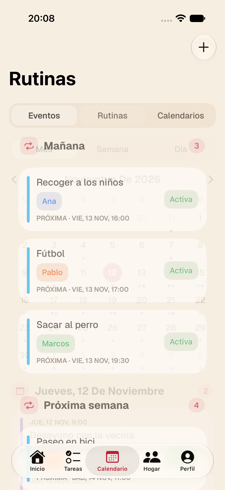 | Rutinas con próxima ocurrencia (`PRÓXIMA · fecha`), estado «Hecha» | «Nueva rutina», marcar hecha |
| Calendarios | 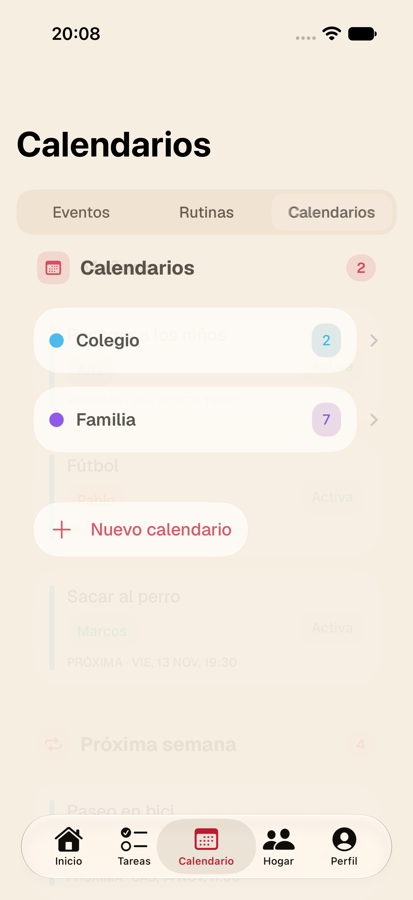 | Calendarios con contador de próximos eventos | «Nuevo calendario», abrir |
| Nuevo evento | 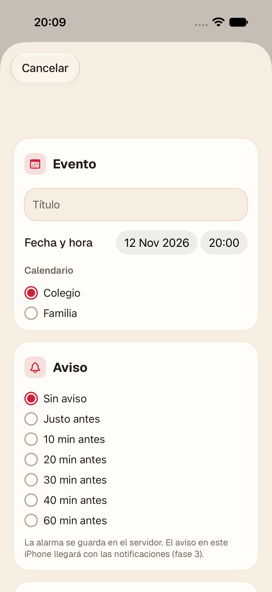 | Título, Fecha y hora, Calendario, personas asignadas | Cancelar, Guardar |
| Nueva rutina | 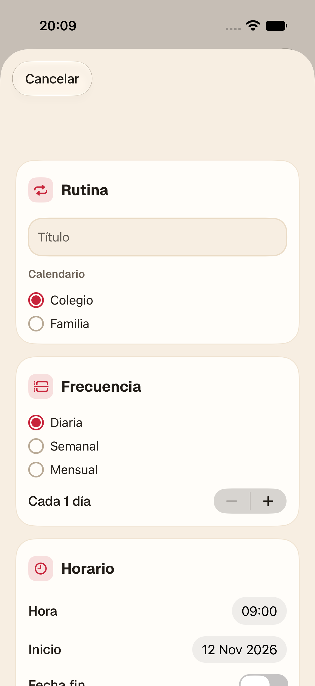 | Título, Calendario, frecuencia (Diaria, Semanal, Mensual), «Cada N» (Stepper), Hora, Inicio, Fecha fin (opcional), Activa | Cancelar, Guardar |
| Nuevo calendario | 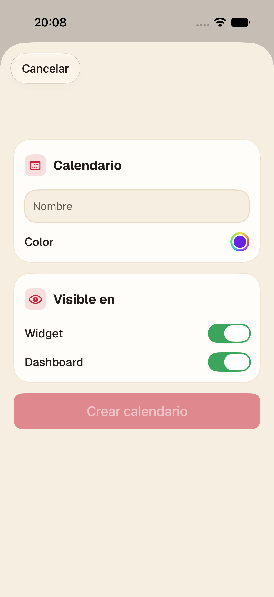 | Nombre, Color, Widget, Dashboard | Cancelar, Crear |

Las sesiones de rutina son de solo lectura; la lista «Próximas sesiones» tiene 10 elementos.

### 4.6 Hogar y administración

| Pantalla | Captura | Qué muestra |
|---|---|---|
| Hogar |  | Hogar activo, miembros («Vinculada», «Sin cuenta», tipo y estado), botón «Invitar», enlace «Administración» |
| Administración | 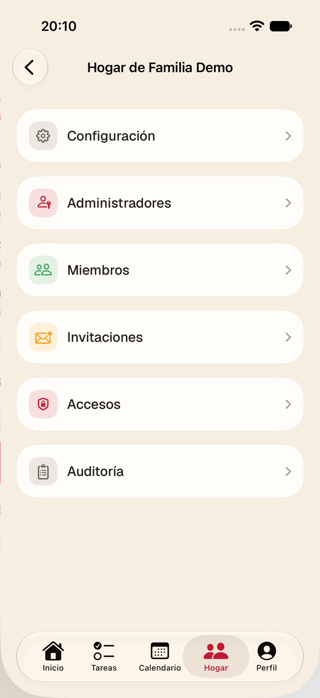 | Menú con seis secciones: Configuración, Administradores, Miembros, Invitaciones, Accesos, Auditoría |
| Configuración | 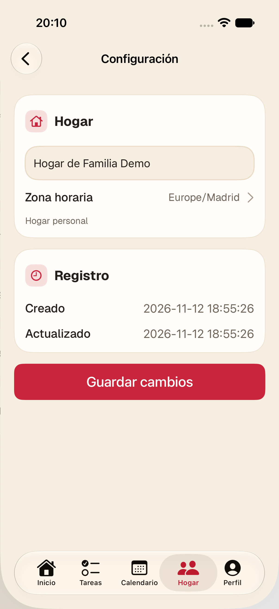 | Nombre del hogar y zona horaria (IANA). Solo el admin edita |
| Administradores | 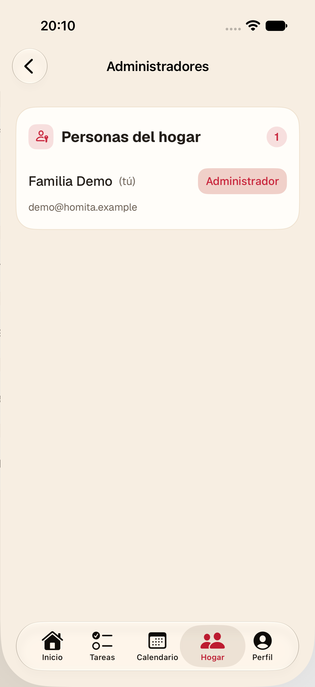 | Admins del hogar: «Hacer admin», «Quitar admin», «Transferir», «Salir» |
| Miembros |  | Personas del hogar con color, tipo y estado. Solo el admin agrega y edita |
| Invitaciones | 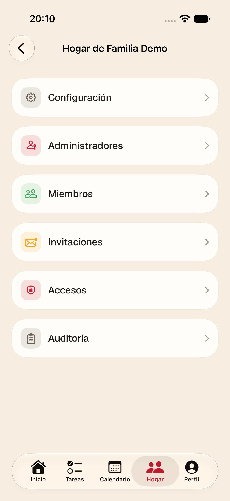 | Invitaciones pendientes; «Crear invitación», «Revocar»; el código se muestra una sola vez |
| Accesos |  | Permisos por miembro. Solo el admin |
| Auditoría |  | Registro de cambios, paginado con «Cargar más» |

### 4.7 Perfil y ajustes

| Pantalla | Captura | Qué muestra | Acciones |
|---|---|---|---|
| Perfil | 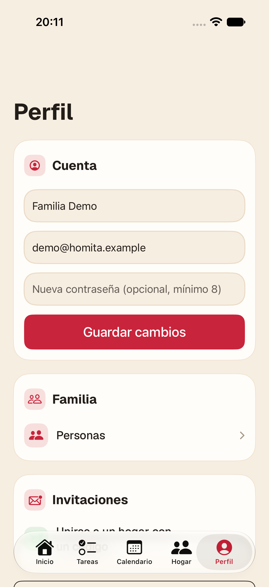 | Secciones Cuenta, Familia, Unirse a un hogar, cerrar sesión | Editar nombre, email y contraseña; cerrar sesión |
| Personas | 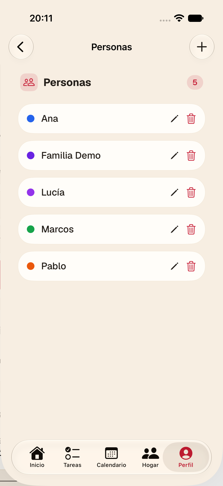 | Personas del hogar. Las compartidas son de solo lectura | «Nueva persona» (nombre, color) |
| Unirse a un hogar | 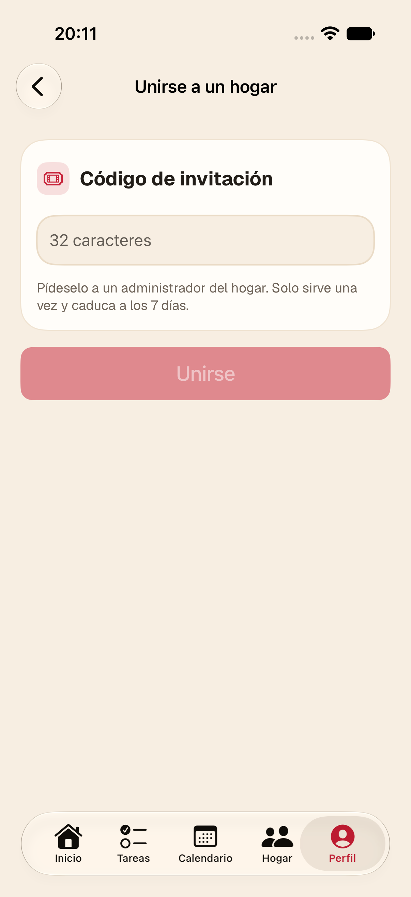 | Campo para el código de invitación | «Unirse» |

## 5. Formularios de alta: resumen

Campos según el código de cada editor (lo que aparece en las capturas está verificado). Las reglas de validación no se probaron en el simulador: se indican solo como referencia del código.

| Formulario | Campos | Endpoint de escritura (verificado en el código) |
|---|---|---|
| Tarea | Título, Lista | `task/create` |
| Lista | Nombre, Color, Widget, Dashboard | `task-list/create` |
| Evento | Título, Fecha y hora, Calendario (y personas asignadas) | ruta de eventos: no verificada, ver sección 6 |
| Rutina | Título, Calendario, frecuencia (Diaria, Semanal, Mensual), intervalo, hora, inicio, fin opcional, activa | `routine/create` |
| Calendario | Nombre, Color, Widget, Dashboard | ruta no verificada, ver sección 6 |
| Persona | Nombre, Color | `person/create` |
| Invitación | Email a invitar, tipo (`adult` solo para admin, `pet` nunca) | `home/invitation/create` |

## 6. Datos y conexiones con el backend

Todas las rutas van a la Edge Function `api` (contrato PHP-compat). Las autenticadas envían `X-Home-Id` salvo `GET home`, `POST home/create` y `PATCH home/default`.

| Área | Lectura | Escritura |
|---|---|---|
| Sesión | `user/auth`, `GET /config` | `user/create`, `user/update` |
| Hogares | `home`, `home/detail`, `home/membership`, `home/audit`, `home/invitation`, `home/member` | `home/create`, `home/update`, `home/default`, `home/member/create`, `home/member/update`, `home/membership/role`, `home/membership/transfer`, `home/invitation/create`, `home/invitation/revoke`, `home/invitation/accept` |
| Permisos | `home/permission` | `home/permission` (set) |
| Tareas | `task`, `task/detail`, `task-list`, `task-list/detail`, `task-list/user` | `task/create`, `task/update`, `task/complete`, `task/order`, `task/delete`, `task-list/create`, `task-list/update`, `task-list/delete` |
| Eventos | `event` (según la búsqueda de rutas del código; filtros por fecha) | Escritura de eventos: no localizada en la búsqueda; revisar `EventRepository.swift` antes de usarla |
| Rutinas | `routine`, `routine/detail` | `routine/create`, `routine/update`, `routine/delete`, `routine/alarm` |
| Calendarios | `calendar`, `calendar/user` | Escritura de calendarios: no localizada en la búsqueda; revisar `CalendarRepository.swift` |
| Personas | `person` | `person/create`, `person/update`, `person/delete` |

Qué se calcula en cliente: rutinas de hoy y «Más próximas» (próxima ocurrencia futura), agrupación de tareas por lista, cuenta atrás de eventos (hora local del reloj del dispositivo).

Persistencia local: el token de sesión y el hogar activo van en Keychain (`active_home_id`). El código de invitación se muestra una vez, vive solo en memoria y no se persiste.

## 7. Estado y comportamiento a tener en cuenta

- **Hogar activo.** Tras login, `HomeContextStore` carga `GET home` y fija el hogar. Sin hogares, Tareas y Calendario muestran «Crear hogar»; Perfil siempre está disponible. Cambiar de hogar reconstruye las pestañas.
- **Permisos.** Hay ocultamiento en cliente y validación en servidor. Un miembro no ve acciones de administración.
- **Hogar personal.** Se puede renombrar. Transferir, quitar y salir no se ofrecen.
- **Cierre de sesión.** Pasa por `AppServices.signOut()`, que limpia el hogar activo.
- **Notificaciones.** No hay avisos en v1: las alarmas se guardan en el servidor pero el iPhone no avisa.
- **Eventos del calendario por día:** cabecera con flechas y selector de fecha, tira de la semana y lista del día; solo eventos (las sesiones de rutina se ven en el segmento Rutinas). Sin vista de mes.
- **Sin widgets, push ni iPad.** Distribución por side-load (firma gratuita, caduca a los 7 días).

## 8. Límites de esta captura

- **Sin estados vacíos ni de error forzados.** El recorrido automático usa el hogar demo, con datos. Los estados «Sin tareas», «Sin eventos», «Sin rutinas», «Sin miembros» y los de error de red no están capturados. Hace falta una segunda pasada con un hogar vacío y con el backend apagado.
- **«+ Evento» en Inicio** no se localizó en el recorrido; el alta de evento sí está capturada desde Calendario.
- **Sin `accessibilityIdentifier`.** Los tests localizan controles por texto visible, así que cambiar un título rompe el recorrido.
- **Una sola cuenta** (demo, admin). No se capturó la vista de un miembro sin permisos de administración.
- **Un solo tamaño** de simulador (iPhone 17). Falta comprobar iPhone chico y Pro Max.
- Algunos textos (p. ej. la confirmación de «Eliminar» y el contenido de los menús de opciones) no se abrieron.
